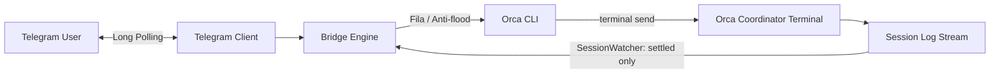

# Telegram Orchestrator

Ponte bidirecional minimalista e resiliente entre seu Telegram e uma sessão de IA/orquestrador rodando no **Orca** nesta máquina local.

A ponte escuta mensagens do seu chat privado via **long polling**, encaminha as instruções diretamente para o terminal do agente via CLI do **Orca**, monitora o log de sessão e devolve **apenas as respostas finais** concluídas pelo assistente, eliminando ruídos de streaming ou repinturas de tela.

---

## ⚡ Início Rápido

### 1. Pré-requisitos
- [Bun](https://bun.sh) instalado (`bun --version`)
- [Orca](https://useorca.com) em execução com CLI disponível (`orca --help`)
- Um bot no Telegram e seu ID de usuário

#### 🤖 Como Criar seu Bot no Telegram (Passo a Passo)
1. No Telegram, procure por **[@BotFather](https://t.me/BotFather)** (verifique o selo azul de verificado).
2. Envie o comando `/newbot`.
3. Escolha um nome para o bot (ex: `Meu Orca Bot`).
4. Escolha um nome de usuário único terminando em `bot` (ex: `meu_orca_assistente_bot`).
5. O BotFather enviará uma mensagem de sucesso contendo o **HTTP API token** (formato: `1234567890:ABCdefGHIjklMNOpqrSTUvwxYZ`). Guarde esse token para o `.env`.
6. Abra uma conversa com o seu bot recém-criado e clique em **Iniciar** (`/start`) ou envie um `Oi`.

#### 🆔 Como Descobrir seu Chat ID / User ID
1. No Telegram, procure pelo bot **[@userinfobot](https://t.me/userinfobot)**.
2. Envie qualquer mensagem para ele (ou `/start`).
3. Ele responderá com o seu **Id** numérico (ex: `383093166`).
4. Em conversas diretas/privadas com seu bot, `ALLOWED_CHAT_ID` e `ALLOWED_USER_ID` têm exatamente esse mesmo valor.
### 2. Configurar o Ambiente
Copie o template e preencha suas chaves:

```bash
cp .env.sample .env
```

Edite o `.env`:
```env
TELEGRAM_BOT_TOKEN="1234567890:ABCdefGHIjklMNOpqrSTUvwxYZ"
ALLOWED_CHAT_ID=383093166
ALLOWED_USER_ID=383093166
```

### 3. Executar

```bash
bun run start
```

---

## 🎮 Comandos Disponíveis no Telegram

Você pode controlar o comportamento da ponte diretamente na conversa com o bot:

| Comando | Descrição |
|---|---|
| `/status` | Exibe se a escuta está ativa/pausada, o terminal Orca vinculado e a fila de mensagens |
| `/listen` | Ativa/retoma o encaminhamento de mensagens para o terminal |
| `/stop` | Pausa o encaminhamento de mensagens (o bot ignora prompts até reativar) |
| `/runs` | Lista os runs de orquestração multi-agente ativos no Orca |
| `/tasks <run_id>` | Lista as tarefas e status de um run do Orca |
| `/clear` | Limpa a fila de mensagens pendentes |
| `/help` | Exibe o menu de ajuda com todos os comandos |

---

## 🧠 Como Funciona a Arquitetura



1. **Long Polling Nativo**: Não requer abertura de portas, IP público ou configuração de webhook (ngrok/cloudflare tunnel).
2. **Autorização Rígida**: Mensagens de qualquer chat ou usuário diferente do configurado são descartadas com aviso de segurança.
3. **Fila e Anti-interrupção**: Se você enviar uma mensagem enquanto o orquestrador ainda estiver executando uma tarefa, ela é enfileirada e enviada após a conclusão, sem interromper nem duplicar prompts.
4. **Sem Ruído (Zero Flood)**: O `SessionWatcher` escuta a conclusão semântica da resposta do assistente (`stopReason === "stop"`). Textos parciais, chamadas de ferramentas e repinturas do TUI não são enviados ao Telegram.
5. **Instância Única**: Lock de arquivo baseado em PID impede que duas instâncias concorram pelo mesmo bot.
6. **Offset Persistente**: Salva o `lastUpdateId` em `state.json` para evitar reprocessar mensagens antigas após reinício.

---

## 🔄 Inicialização Automática no macOS (Launchd)

Para manter a ponte sempre ativa em segundo plano e iniciar automaticamente no login:

1. Crie o arquivo `~/Library/LaunchAgents/dev.cassino.telegram-orchestrator.plist`:

```xml
<?xml version="1.0" encoding="UTF-8"?>
<!DOCTYPE plist PUBLIC "-//Apple//DTD PLIST 1.0//EN" "http://www.apple.com/DTDs/PropertyList-1.0.dtd">
<plist version="1.0">
<dict>
    <key>Label</key>
    <string>dev.cassino.telegram-orchestrator</string>
    <key>ProgramArguments</key>
    <array>
        <string>/usr/local/bin/bun</string>
        <string>run</string>
        <string>index.ts</string>
    </array>
    <key>WorkingDirectory</key>
    <string>/Users/renatocassino/projects/personal/telegram-orchestrator</string>
    <key>KeepAlive</key>
    <true/>
    <key>StandardOutPath</key>
    <string>/Users/renatocassino/projects/personal/telegram-orchestrator/bridge.log</string>
    <key>StandardErrorPath</key>
    <string>/Users/renatocassino/projects/personal/telegram-orchestrator/bridge.err.log</string>
</dict>
</plist>
```
*(Substitua o caminho do binário do Bun pelo retornado por `which bun`).*

2. Ative o serviço:
```bash
launchctl load ~/Library/LaunchAgents/dev.cassino.telegram-orchestrator.plist
```

3. Para desativar:
```bash
launchctl unload ~/Library/LaunchAgents/dev.cassino.telegram-orchestrator.plist
```

---

## 🧪 Testes

Para rodar os testes unitários da ponte:

```bash
bun test
```

## 📄 Licença

MIT
