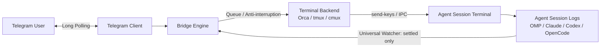

# AgentWalkie

Two-way walkie-talkie connecting your mobile messengers (Telegram, Discord coming soon) directly to local AI coding agent sessions (**Orca, Claude Code, Codex, OpenCode, Cursor**) running inside terminal multiplexers (**Orca, tmux, cmux**).

AgentWalkie receives prompts via long polling, dispatches them to your selected terminal target, watches the agent's session log stream, and relays back **only settled assistant responses** — zero streaming clutter, zero TUI repaints.

---

## ⚡ Quick Start

### 1. Prerequisites
- [Bun](https://bun.sh) runtime (`bun --version`)
- A terminal multiplexer or agent runner: [Orca](https://useorca.com), `tmux`, or `cmux`
- A Telegram bot and your Telegram numeric user ID

#### 🤖 Creating a Telegram Bot (Step-by-Step)
1. On Telegram, message **[@BotFather](https://t.me/BotFather)** (check for the verified badge).
2. Send `/newbot`.
3. Choose a display name (e.g. `My Agent Walkie`).
4. Choose a unique username ending in `bot` (e.g. `my_agent_walkie_bot`).
5. BotFather will provide your **HTTP API token** (format: `1234567890:ABCdefGHIjklMNOpqrSTUvwxYZ`). Save this for your `.env`.
6. Open a conversation with your newly created bot and click **Start** (`/start`) or send `Hi`.

#### 🆔 Finding Your Chat ID / User ID
1. On Telegram, message **[@userinfobot](https://t.me/userinfobot)**.
2. Send any message or `/start`.
3. It will reply with your numeric **Id** (e.g. `383093166`).
4. In 1-on-1 private conversations with your bot, `ALLOWED_CHAT_ID` and `ALLOWED_USER_ID` share this exact value.

---

### 2. Configure Environment
Copy template and fill your credentials:

```bash
cp .env.sample .env
```

Edit `.env`:
```env
TELEGRAM_BOT_TOKEN="1234567890:ABCdefGHIjklMNOpqrSTUvwxYZ"
ALLOWED_CHAT_ID=383093166
ALLOWED_USER_ID=383093166
# Optional: defaults to "orca" (supports "orca", "tmux", "cmux")
# TERMINAL_BACKEND=orca
```

---

### 3. Run

```bash
bun run start
```

---

## 🎮 Telegram In-Chat Commands

Control the bridge behavior directly from your Telegram conversation:

| Command | Description |
|---|---|
| `/status` | View active backend, target handle/pane, listening status, and queue depth |
| `/listen` | Resume dispatching incoming Telegram prompts to the terminal |
| `/stop` | Pause dispatching (messages are held without sending to terminal) |
| `/backend <orca\|tmux\|cmux>` | Switch active terminal multiplexer on the fly |
| `/targets` | List available windows, panes, or tabs on the current backend |
| `/runs` | List active multi-agent orchestration runs (Orca backend) |
| `/tasks <run_id>` | List tasks and statuses for an orchestration run |
| `/clear` | Clear the pending message queue |
| `/help` | Show command reference |

---

## 🧠 Architecture & Zero-Noise Guarantee



1. **Native Long Polling**: No exposed webhooks, public IPs, or tunnels (e.g. ngrok/cloudflare tunnel) required.
2. **Strict Access Guard**: Only prompts originating from `ALLOWED_USER_ID` and `ALLOWED_CHAT_ID` are processed. All others are blocked.
3. **Queue & Anti-Interruption**: New messages arriving while an agent is executing are enqueued and submitted sequentially upon turn completion.
4. **Zero-Flood Settled Filter**: Responses are collected by parsing structured session logs (`stopReason: "stop"` / completed assistant turns). Progress spinners, bash tool traces, and terminal repaints are never leaked to Telegram.
5. **Single-Instance PID Lock**: File lock (`.bridge.lock`) prevents multiple processes from polling the same bot token simultaneously.
6. **Offset State Persistence**: Saves `lastUpdateId` in `state.json` across restarts.

---

## 🔄 Background Service on macOS (Launchd)

To keep AgentWalkie running continuously and launch automatically on login:

1. Create `~/Library/LaunchAgents/dev.cassino.agentwalkie.plist`:

```xml
<?xml version="1.0" encoding="UTF-8"?>
<!DOCTYPE plist PUBLIC "-//Apple//DTD PLIST 1.0//EN" "http://www.apple.com/DTDs/PropertyList-1.0.dtd">
<plist version="1.0">
<dict>
    <key>Label</key>
    <string>dev.cassino.agentwalkie</string>
    <key>ProgramArguments</key>
    <array>
        <string>/usr/local/bin/bun</string>
        <string>run</string>
        <string>index.ts</string>
    </array>
    <key>WorkingDirectory</key>
    <string>/Users/renatocassino/projects/personal/telegram-orchestrator</string>
    <key>KeepAlive</key>
    <true/>
    <key>StandardOutPath</key>
    <string>/Users/renatocassino/projects/personal/telegram-orchestrator/bridge.log</string>
    <key>StandardErrorPath</key>
    <string>/Users/renatocassino/projects/personal/telegram-orchestrator/bridge.err.log</string>
</dict>
</plist>
```
*(Verify your bun path using `which bun`).*

2. Load the service:
```bash
launchctl load ~/Library/LaunchAgents/dev.cassino.agentwalkie.plist
```

3. Unload / stop:
```bash
launchctl unload ~/Library/LaunchAgents/dev.cassino.agentwalkie.plist
```

---

## 🧪 Tests

Run test suite:

```bash
bun test
```

## 📄 License

MIT
